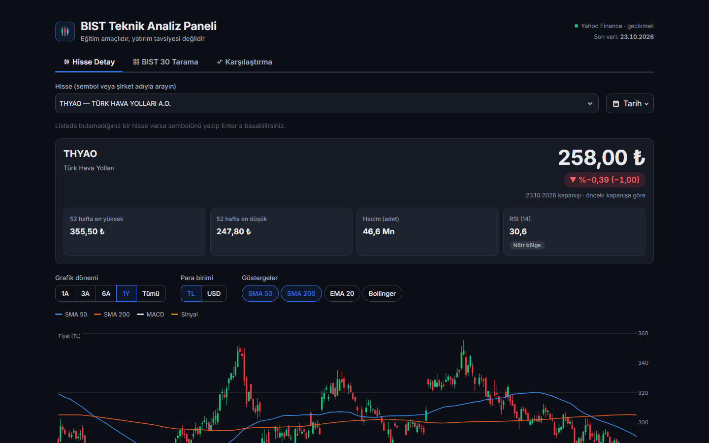
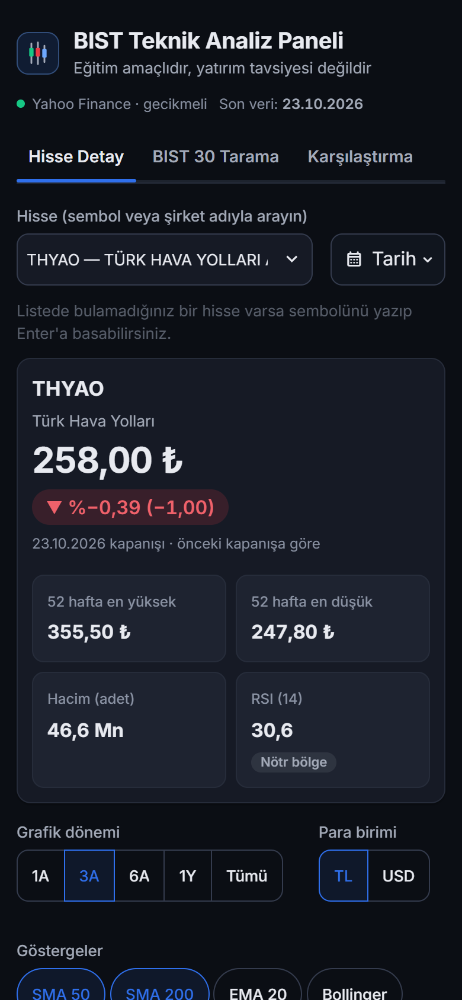
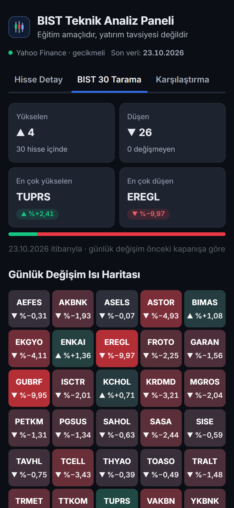
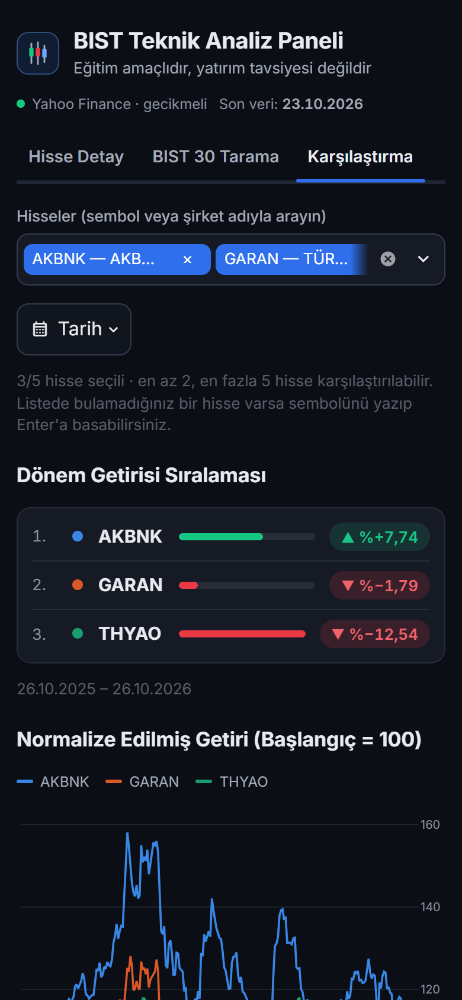
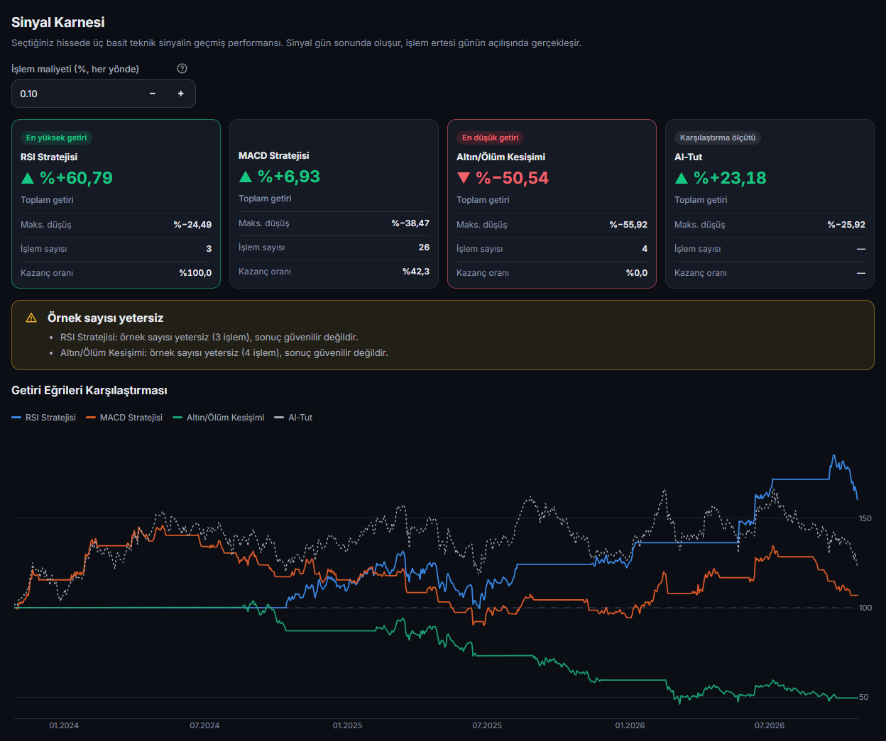

# BIST 30 Teknik Analiz Paneli

Borsa İstanbul'daki BIST 30 endeksi hisseleri için teknik analiz göstergelerini
görselleştiren, Streamlit ile yazılmış Türkçe bir web uygulaması.



<p align="center">
  
  
  
</p>

## English summary

A Turkish-language technical analysis dashboard for Turkey's BIST stocks,
built with Streamlit. It fetches daily OHLCV data from Yahoo Finance and
computes SMA, EMA, RSI (Wilder's method), MACD and Bollinger Bands from
scratch with pandas/numpy (no third-party TA library). Three tabs: a
single-stock detail view — searchable across all ~790 Borsa İstanbul-listed
companies, not just the top 30 — with candlestick charts, a plain-language
technical summary, a TL/USD currency toggle, and a **"Sinyal Karnesi"**
section that backtests three simple long-only signals (RSI oversold/
overbought, MACD crossover, 50/200 SMA golden/death cross) with strict
no-look-ahead execution (signal at close, trade at next day's open) and
configurable transaction costs; a sortable/filterable screener for the
BIST 30 constituents with a daily-change heatmap; and a multi-stock
comparison view with normalized returns and a correlation heatmap.
Educational project — not investment advice.

## Özellikler

### 📈 Hisse Detay
- Borsa İstanbul'da işlem gören **~790 hissenin tamamında** sembol veya şirket adıyla arama (sadece BIST 30 değil); listede bulamadığınız bir sembolü elle de girebilirsiniz
- Üstte özet kartı: son fiyat, günlük değişim rozeti (▲/▼), 52 hafta en yüksek/en düşük, hacim, RSI
- Mum grafiği + hacim; SMA(50)/SMA(200)/EMA(20)/Bollinger Bantları "chip" düğmeleriyle aç-kapa
- Grafik dönemi seçimi (1A / 3A / 6A / 1Y / Tümü) — telefonda varsayılan son 3 ay
- Altta ayrı paneller halinde RSI (30/70 referans çizgileriyle) ve MACD
- **TL / USD görünüm anahtarı** — fiyatlar ve tüm göstergeler USDTRY kuruyla gerçek zamanlı dönüştürülür (kur etkisinden arındırılmış performans için)
- **Teknik Özet** kartı: RSI bölgesi, MACD kesişimi, fiyatın hareketli ortalamalara göre konumu, altın/ölüm kesişimi — rozetli satırlar halinde, tamamen tarafsız dille, "AL/SAT" ifadesi hiç kullanılmaz
- Her gösterge yanında "Bu ne anlama gelir?" açılır açıklama kutusu

### 🎯 Sinyal Karnesi (backtest)


Hisse Detay sekmesinin içinde, üç basit teknik sinyalin **geçmiş performansını** gösteren bölüm:
- RSI(14) aşırı satım/alım, MACD kesişimi, SMA 50/200 altın/ölüm kesişimi — ve "Al-Tut" karşılaştırması
- **İleriye bakış (look-ahead) hatası yok**: sinyal bir günün kapanışında oluşur, işlem ancak ertesi günün açılışında gerçekleşir
- Sabit, hisseye özel optimize edilmemiş parametreler; sadece uzun (long) pozisyon, kaldıraç yok
- Ayarlanabilir işlem maliyeti (varsayılan %0,1, her yönde)
- Bedelsiz sermaye artırımı/temettü düzeltmeli fiyatlarla hesaplanır
- Her strateji ve Al-Tut için kart: toplam getiri, maksimum düşüş, işlem sayısı, kazanç oranı; en yüksek / en düşük getiri vurgulanır
- Getiri eğrileri karşılaştırması; fiyat grafiğinde işaretlenmiş giriş/çıkış noktaları
- İşlem sayısı 10'un altındaysa "örnek sayısı yetersiz" uyarısı

### 🔍 BIST 30 Tarama
- Özet şeridi: yükselen / düşen hisse sayısı, en çok yükselen ve en çok düşen
- Günlük değişime göre renklendirilmiş ısı haritası (telefonda 5, geniş ekranda 6 sütun)
- Tablo görünümü (sütun başlığına tıklayarak sıralama) veya telefona uygun kompakt liste görünümü
- Trend durumuna ve hisse/şirket adına göre filtreleme

### ⚖️ Karşılaştırma
- Borsa İstanbul'daki tüm hisseler arasından 2 ile 5 arasında seçip aynı grafikte karşılaştırın
- Dönem getirisi sıralaması kartı
- Başlangıcı 100 kabul eden normalize edilmiş getiri grafiği (farklı fiyat seviyelerindeki hisseleri adil karşılaştırmak için)
- Seçilen hisselerin günlük getirileri arasındaki korelasyon ısı haritası

## Kurulum

```powershell
git clone https://github.com/mehmet-yuksell/Bist30.git
cd Bist30
python -m venv venv
.\venv\Scripts\Activate.ps1
pip install -r requirements.txt
streamlit run app.py
```

Uygulama `http://localhost:8501` adresinde açılır.

## Testler

```powershell
pytest tests/ -v
```

`indicators.py` içindeki SMA, EMA, RSI ve MACD hesaplamaları, elle (kapalı
formülle) doğrulanmış küçük örnek verilerle test edilir. `ui/format.py`'deki
Türkçe sayı/tarih biçimlendirmesi ve arayüz metinlerinde "AL/SAT" ifadesinin
geçmediği de test edilir.

Görsel (tarayıcı) testleri için geliştirme bağımlılıkları ayrıdır:

```powershell
pip install -r requirements-dev.txt
playwright install chromium
```

## Streamlit Community Cloud'a Dağıtım

1. Projeyi GitHub'a push edin (bkz. yukarıdaki kurulum adımları / commit geçmişi)
2. [share.streamlit.io](https://share.streamlit.io) adresine GitHub hesabınızla giriş yapın
3. "New app" düğmesine tıklayın
4. Repository, branch (`main`) ve ana dosya olarak `app.py` seçin
5. "Deploy" düğmesine tıklayın — birkaç dakika içinde uygulamanız yayında olur

## Proje Yapısı

```
app.py              Giriş noktası: sayfa ayarları, başlık, sekmeler, alt bilgi
tabs/
  hisse_detay.py    Hisse Detay sekmesi + Teknik Özet + Sinyal Karnesi
  tarama.py         BIST 30 Tarama sekmesi
  karsilastirma.py  Karşılaştırma sekmesi
ui/
  theme.py          Tasarım token'ları (renk, boşluk, yarıçap) — CSS ve Plotly ortak kaynağı
  styles.py         CSS tasarım sistemi + mobil öncelikli medya sorguları
  components.py     HTML bileşenleri (hero, kartlar, rozetler, ısı haritası, liste, durumlar)
  charts.py         Plotly grafik oluşturucuları (ortak mobil/masaüstü düzeni)
  controls.py       Ortak form kontrolleri (hisse arama, tarih aralığı)
  format.py         Türkçe sayı/tarih biçimlendirme (1.234,56 · %+1,23 · gg.aa.yyyy)
  viewport.py       Ekran genişliği sınıfını (telefon/tablet/masaüstü) Python'a bildirir
config.py           BIST 30 hisse listesi (son güncelleme tarihiyle birlikte)
data.py             Yahoo Finance'den veri çekme, önbellekleme, hata yönetimi
indicators.py       SMA, EMA, RSI (Wilder), MACD, Bollinger Bantları — sıfırdan
signals.py          Gösterge değerlerinden tarafsız Türkçe gözlem metinleri
backtest.py         Sinyal Karnesi: look-ahead içermeyen basit backtest motoru
ui_text.py          Tüm arayüz metinleri (tek merkezden yönetim)
data/bist_all.csv   KAP kaynaklı, Borsa İstanbul'daki tüm şirketlerin listesi
tests/              pytest testleri
docs/               Ekran görüntüleri
```

## Mobil uyumluluk

Arayüz önce 390 px genişlik (iPhone 14) için tasarlandı, sonra tablet ve
masaüstüne genişletildi:

- **Kırılım noktaları:** < 768 px telefon, 768–1023 px tablet, ≥ 1024 px masaüstü.
  Düzenin asıl kaynağı CSS medya sorgularıdır; grafik yüksekliği, varsayılan
  grafik dönemi ve liste/tablo seçimi gibi Python'da verilmesi gereken kararlar
  için `ui/viewport.py` ekran genişliğini Streamlit'in yerleşik bileşen API'siyle
  (ek paket olmadan) ölçer.
- **Yatay kaydırma yok:** 390, 768 ve 1440 px genişliklerde her sekme Playwright
  ile ölçüldü (`scrollWidth ≤ innerWidth`); `overflow-x: hidden` ile gizlenmedi.
- **Dokunma hedefleri** telefon ve tablette en az 44 px (sekmeler, düğmeler,
  seçim kutuları, chip'ler).
- **Grafikler** telefonda sabit eksenli: grafiğin üzerinde parmakla kaydırmak
  sayfayı kaydırır, yakınlaştırmaz (dokunma olaylarıyla test edildi). Lejant
  grafiğin üstünde HTML olarak durur ve satır kırar; araç çubuğu telefonda gizli.
- **Telefonda** metrikler 2×2 ızgara, sütunlar alt alta, tarama sonuçları kompakt
  liste, tarih aralığı varsayılan olarak kapalı bir "Tarih" panelinde.

## Tasarım sistemi

- **Renkler** `ui/theme.py`'de tek yerde: koyu zemin `#0B0E14`, kart `#161A25`,
  yükseliş `#16C784`, düşüş `#EA3943` (metinde kontrast için `#F0616A`), tek vurgu
  rengi mavi. Yön her zaman renge ek olarak ▲/▼ ve +/− ile gösterilir.
- **Kontrast:** tüm metin renkleri kart yüzeyinde en az 4.5:1 (WCAG AA);
  klavye odağı görünür halkayla belirtilir.
- **Ölçekler:** boşluk 4/8/12/16/24/32 px, köşe yarıçapı 8/12 px, başlıklar
  `clamp()` ile ölçeklenir; rakamlar `tabular-nums` ile hizalı.
- **Tipografi:** Inter (Google Fonts), yoksa sistem sans-serif.
- **Seri renkleri** renk körlüğü simülasyonuyla doğrulanmış sabit bir sıradan
  gelir; korelasyon ısı haritası bilinçli olarak yön renkleri (yeşil/kırmızı)
  yerine nötr mavi–kırmızı ıraksak skala kullanır.

## Teknoloji

Python 3.11+, Streamlit, yfinance, pandas, numpy, plotly, pytest. Teknik
göstergeler hazır bir kütüphane (ör. pandas-ta) kullanılmadan, pandas/numpy
ile sıfırdan yazılmıştır.

## Sınırlamalar

- **BIST 30 listesi sabittir.** Endeks bileşenleri üç ayda bir değişebilir;
  bu projedeki liste `config.py` içinde belirtilen tarihte doğrulanmıştır ve
  otomatik güncellenmez.
- **Veriler gecikmelidir.** Yahoo Finance üzerinden alınan fiyatlar gerçek
  zamanlı değildir.
- **Eğitim amaçlıdır, yatırım tavsiyesi değildir.** Göstergeler yalnızca
  geçmiş fiyat hareketlerine dayanır ve geleceği garanti etmez.
- **Tek veri kaynağına bağımlıdır.** Yahoo Finance'in erişilemediği
  durumlarda veri gelmeyebilir (uygulama bu durumda çökmez, anlaşılır bir
  hata mesajı gösterir).
- **BIST 30 Tarama her zaman sadece 30 hisseyi gösterir.** Hisse Detay ve
  Karşılaştırma'daki geniş arama (tüm Borsa İstanbul) bilinçli olarak bu
  sekmeye uygulanmadı; yüzlerce hisseyi tek seferde çekmek Yahoo
  Finance'in hız sınırlarına takılabilir.
- **Sinyal Karnesi gerçek bir yatırım stratejisi değildir, basitleştirilmiş
  bir eğitim modelidir.** Vergi, kayma (slippage) ve likidite dikkate
  alınmaz; parametreler sabittir ve hisseye özel optimize edilmemiştir;
  geçmiş performans gelecek için garanti değildir. Az sayıda sinyal
  üreten dönemlerde (özellikle altın/ölüm kesişimi gibi nadir sinyallerde)
  sonuçlar istatistiksel olarak güvenilir olmayabilir — bu durumda
  uygulama açıkça uyarır.
- **TL/USD dönüşümü yalnızca Hisse Detay grafiğine uygulanır**, Sinyal
  Karnesi her zaman TL bazlı hesaplanır.
- **Bazı Streamlit bileşenleri tam Türkçe biçimlenemez.** Örneğin işlem
  maliyeti sayı kutusu ondalık ayırıcı olarak nokta gösterir (0.10); bu,
  Streamlit'in yerleşik bileşeninin sınırıdır.

---

*Yatırım tavsiyesi değildir. Veriler Yahoo Finance üzerinden alınır ve
gecikmeli olabilir. Eğitim amaçlı bir projedir.*
