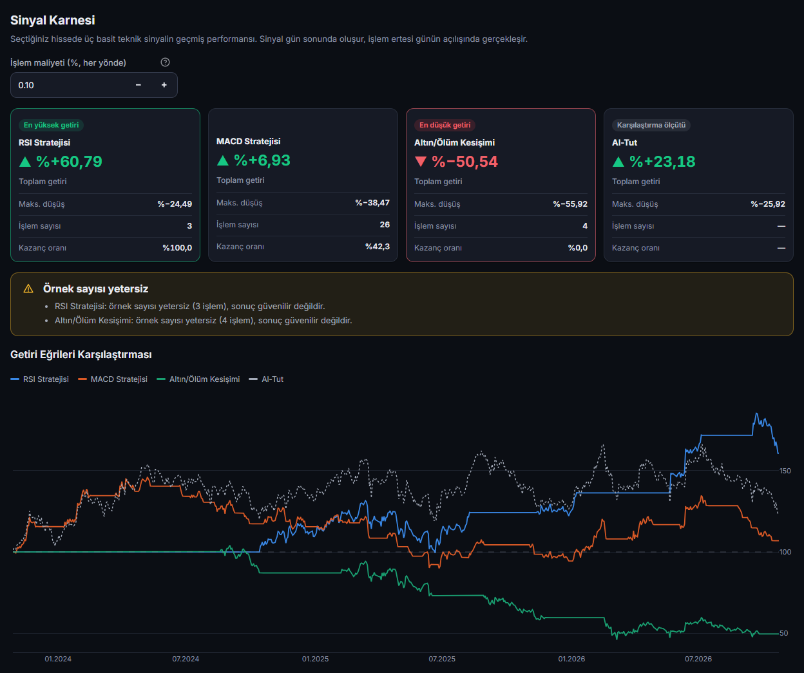

# BIST 100 Teknik Analiz Paneli

**[▶ Canlı demo](https://bist30-opsputfhf9b9i6kkjnyefc.streamlit.app/)** · [](https://github.com/mehmet-yuksell/Bist30/actions/workflows/ci.yml)

Borsa İstanbul'daki BIST 100 endeksi hisseleri için teknik analiz göstergelerini
görselleştiren, Streamlit ile yazılmış Türkçe bir web uygulaması.


<p align="center">
  
  
  
</p>

## English summary

A Turkish-language technical analysis dashboard for Turkey's BIST stocks,
built with Streamlit. It fetches daily OHLCV data from Yahoo Finance and
computes SMA, EMA, RSI (Wilder's method), MACD and Bollinger Bands from
scratch with pandas/numpy (no third-party TA library). Three tabs: a
single-stock detail view — searchable across the ~630 Borsa İstanbul stocks
that have current Yahoo Finance data, not just the top 100 — with candlestick charts, a plain-language
technical summary, a TL/USD currency toggle, and a **"Sinyal Karnesi"**
section that backtests three simple long-only signals (RSI oversold/
overbought, MACD crossover, 50/200 SMA golden/death cross) with strict
no-look-ahead execution (signal at close, trade at next day's open) and
configurable transaction costs; a screener for the BIST 100 constituents
ranked by the **Bluetsman buy system** (a TradingView Pine Script indicator
ported 1:1 to pandas: EMA 13/34 crossover + volume + RSI + momentum + MACD +
Supertrend + ADX, scored 0-100); and a multi-stock
comparison view with normalized returns and a correlation heatmap.
Educational project — not investment advice.

## Özellikler

### 📈 Hisse Detay
- Borsa İstanbul'da Yahoo Finance'te güncel verisi bulunan **~630 hissenin tamamında** sembol veya şirket adıyla arama (sadece BIST 100 değil); listede yalnızca sonuç gösterebilen hisseler yer alır
- Üstte özet kartı: son fiyat, günlük değişim rozeti (▲/▼), 52 hafta en yüksek/en düşük, hacim, RSI
- Mum grafiği + hacim; SMA(50)/SMA(200)/EMA(20)/Bollinger Bantları "chip" düğmeleriyle aç-kapa
- Grafik dönemi seçimi (1A / 3A / 6A / 1Y / Tümü) — telefonda varsayılan son 3 ay
- Altta ayrı paneller halinde RSI (30/70 referans çizgileriyle) ve MACD
- **TL / USD görünüm anahtarı** — fiyatlar ve tüm göstergeler USDTRY kuruyla gerçek zamanlı dönüştürülür (kur etkisinden arındırılmış performans için)
- **Teknik Özet** kartı: RSI bölgesi, MACD kesişimi, fiyatın hareketli ortalamalara göre konumu, altın/ölüm kesişimi — rozetli satırlar halinde, tamamen tarafsız dille, "AL/SAT" ifadesi hiç kullanılmaz (alım sinyali yalnızca Bluetsman bölümünde, göstergenin kendi adıyla geçer)
- Her gösterge yanında "Bu ne anlama gelir?" açılır açıklama kutusu

### 🎯 Sinyal Karnesi (backtest)


Hisse Detay sekmesinin içinde, üç basit teknik sinyalin **geçmiş performansını** gösteren bölüm:
- RSI(14) aşırı satım/alım, MACD kesişimi, SMA 50/200 altın/ölüm kesişimi — ve "Al-Tut" karşılaştırması
- **İleriye bakış (look-ahead) hatası yok**: sinyal bir günün kapanışında oluşur, işlem ancak ertesi günün açılışında gerçekleşir
- Sabit, hisseye özel optimize edilmemiş parametreler; sadece uzun (long) pozisyon, kaldıraç yok
- Ayarlanabilir işlem maliyeti (varsayılan %0,1, her yönde)
- Bedelsiz sermaye artırımı/temettü düzeltmeli fiyatlarla hesaplanır
- Her strateji ve Al-Tut için kart: toplam getiri, maksimum düşüş, işlem sayısı, kazanç oranı; en yüksek / en düşük getiri vurgulanır
- Getiri eğrileri karşılaştırması; fiyat grafiğinde işaretlenmiş giriş/çıkış noktaları
- İşlem sayısı 10'un altındaysa "örnek sayısı yetersiz" uyarısı

### 🔍 BIST 100 Tarama (açılış sekmesi)
- **Bugünün Alım Sinyalleri:** son işlem gününde alım sinyali veren hisseler, alım skoruna göre
  kartlar halinde (kod, şirket, skor, fiyat, günlük değişim, stop, hedef, RSI, hacim katı).
  Bugün sinyal yoksa son 5 işlem günündeki sinyaller (kaç gün önce, sinyal fiyatı, sinyalden bu
  yana değişim) listelenir.
- Üstte son veri tarihi, son güncelleme saati ve piyasa durumu (Açık / Kapalı) ile "Şimdi yenile"
  düğmesi (en fazla 2 dakikada bir). Seans sürerken bugünkü sinyaller "Ön sinyal" olarak ayrı
  gösterilir; sinyaller kapanışla kesinleşir.
- Liste Borsa İstanbul'un resmî endeks bileşen dosyasından alınır (`config.py`, kaynak ve tarihle)
- Her hisse için 0-100 alım skoru, son sinyalin kaç gün önce oluştuğu, RSI ve hacim katı;
  "Son 10 günde sinyal verenler" filtresi ve hisse/şirket adıyla arama
- Görünüm cihaza göre seçilir: masaüstünde sıralanabilir tablo, telefonda kompakt liste

### 🔷 Bluetsman Alım Sistemi (`tarayici_motor.py`)
Bluetsman Alım/Sat v2 mantığının Python hesaplama motoru; panel kısa vade (günlük grafik)
ayarını kullanır:
- **Alım skoru (0-100):** kesişim tazeliği 15, fiyat > EMA 34 10, Supertrend 10, RSI 15,
  hacim 15, MACD 15, momentum 10, ADX 10
- **Sinyal:** EMA 13/34 kesişiminden sonra en çok 3 işlem günü içinde, fiyat EMA 34 üzerinde,
  haftalık kapanış 20 haftalık EMA üzerinde ve skor ≥ 60; her kesişime tek sinyal.
  Stop = kapanış − 1,5 ATR, hedef = kapanış + 3 ATR.
- Hisse Detay'da: grafikte EMA 13/34 ve geçmiş sinyaller için mavi üçgenler, skorun kalem kalem
  kırılımı (puan / maksimum), geçmiş sinyaller (stop, hedef, 10 işlem günü sonraki getiri)
- Hesap temettü düzeltmeli fiyatla yapılır (`motor_veri.py`: Yahoo'nun Adj Close / Close oranı)

### ⏱️ Güncel veri (`market.py`, `feed.py`)
- Önbellek piyasa saatine göre (Europe/Istanbul): seansta 15 dakikada bir, seans dışında bir
  sonraki açılışa kadar aynı veri. Yahoo verisi ~15 dakika gecikmeli olduğu için kapanış verisi
  18:40'a kadar yenilenir.
- Sayfa açık kalırsa Tarama ve Hisse Detay 15 dakikada bir kendini yeniler; sekme, arama ve
  filtre seçimleri korunur.
- Yahoo hata verir ya da veri boş/eksik gelirse son başarılı veri gösterilir ve "Veri
  güncellenemedi, X dakika önceki veri gösteriliyor" uyarısı çıkar.
- Resmî tatiller ayrıca tutulmaz: son verinin tarihi bugün değilse piyasa kapalı gösterilir.

### ⚖️ Karşılaştırma
- Aynı ~630 hisselik liste arasından 2 ile 5 arasında seçip aynı grafikte karşılaştırın
- Dönem getirisi sıralaması kartı
- Başlangıcı 100 kabul eden normalize edilmiş getiri grafiği (farklı fiyat seviyelerindeki hisseleri adil karşılaştırmak için)
- Seçilen hisselerin günlük getirileri arasındaki korelasyon ısı haritası

## Kurulum

```powershell
git clone https://github.com/mehmet-yuksell/Bist30.git
cd Bist30
python -m venv venv
.\venv\Scripts\Activate.ps1
pip install -r requirements.txt
streamlit run app.py
```

Uygulama `http://localhost:8501` adresinde açılır.

## Testler

```powershell
pytest tests/ -v
```

`indicators.py` içindeki SMA, EMA, RSI ve MACD hesaplamaları, elle (kapalı
formülle) doğrulanmış küçük örnek verilerle test edilir. `ui/format.py`'deki
Türkçe sayı/tarih biçimlendirmesi ve arayüz metinlerinde "AL/SAT" ifadesinin
geçmediği de test edilir.

Görsel (tarayıcı) testleri için geliştirme bağımlılıkları ayrıdır:

```powershell
pip install -r requirements-dev.txt
playwright install chromium
```

## Streamlit Community Cloud'a Dağıtım

1. Projeyi GitHub'a push edin (bkz. yukarıdaki kurulum adımları / commit geçmişi)
2. [share.streamlit.io](https://share.streamlit.io) adresine GitHub hesabınızla giriş yapın
3. "New app" düğmesine tıklayın
4. Repository, branch (`main`) ve ana dosya olarak `app.py` seçin
5. "Deploy" düğmesine tıklayın — birkaç dakika içinde uygulamanız yayında olur

## Proje Yapısı

```
app.py              Giriş noktası: sayfa ayarları, başlık, sekmeler, alt bilgi
tabs/
  hisse_detay.py    Hisse Detay sekmesi + alım sistemi kırılımı + Teknik Özet + Sinyal Karnesi
  tarama.py         BIST 100 Tarama: Bugünün Alım Sinyalleri + alım skorlu liste
  karsilastirma.py  Karşılaştırma sekmesi
ui/
  theme.py          Tasarım token'ları (renk, boşluk, yarıçap) — CSS ve Plotly ortak kaynağı
  styles.py         CSS tasarım sistemi + mobil öncelikli medya sorguları
  components.py     HTML bileşenleri (hero, kartlar, rozetler, sinyal kartı, liste, durumlar)
  charts.py         Plotly grafik oluşturucuları (ortak mobil/masaüstü düzeni)
  controls.py       Ortak form kontrolleri (hisse arama, tarih aralığı)
  format.py         Türkçe sayı/tarih biçimlendirme (1.234,56 · %+1,23 · gg.aa.yyyy)
  viewport.py       Ekran genişliği sınıfını (telefon/tablet/masaüstü) Python'a bildirir
config.py           BIST 100 hisse listesi (Borsa İstanbul kaynağı ve tarihiyle)
data.py             Yahoo Finance'den veri çekme, önbellekleme, hata yönetimi
indicators.py       SMA, EMA, RSI (Wilder), MACD, Bollinger Bantları — sıfırdan
signals.py          Gösterge değerlerinden tarafsız Türkçe gözlem metinleri
tarayici_motor.py   Bluetsman Alım/Sat v2 hesaplama motoru (skor, sinyal, stop/hedef, isabet testi)
motor_veri.py       data.py çıktısı -> motor girdisi (temettü düzeltmesi) ve sinyal özetleri
market.py           BIST seans saati ve önbellek zaman dilimi (Europe/Istanbul)
feed.py             Piyasa saatine göre güncel veri, son başarılı veriye dönüş, yenileme sınırı
bluetsman.py        Eski 8 koşullu Bluetsman (Pine) aktarımı; panelde artık kullanılmıyor
backtest.py         Sinyal Karnesi: look-ahead içermeyen basit backtest motoru
ui_text.py          Tüm arayüz metinleri (tek merkezden yönetim)
data/bist_all.csv   KAP kaynaklı şirket listesi + Yahoo'da güncel verisi olup olmadığı (yahoo_data)
tools/
  update_yahoo_coverage.py  bist_all.csv'deki yahoo_data işaretlerini yeniden hesaplar
  check_bist100.py          config'teki BIST 100 listesini Borsa İstanbul'un güncel dosyasıyla karşılaştırır
tests/              pytest testleri
docs/               Ekran görüntüleri
```

## Mobil uyumluluk

Arayüz önce 390 px genişlik (iPhone 14) için tasarlandı, sonra tablet ve
masaüstüne genişletildi:

- **Kırılım noktaları:** < 768 px telefon, 768–1023 px tablet, ≥ 1024 px masaüstü.
  Düzenin asıl kaynağı CSS medya sorgularıdır; grafik yüksekliği, varsayılan
  grafik dönemi ve liste/tablo seçimi gibi Python'da verilmesi gereken kararlar
  için `ui/viewport.py` ekran genişliğini Streamlit'in yerleşik bileşen API'siyle
  (ek paket olmadan) ölçer.
- **Yatay kaydırma yok:** 390, 768 ve 1440 px genişliklerde her sekme Playwright
  ile ölçüldü (`scrollWidth ≤ innerWidth`); `overflow-x: hidden` ile gizlenmedi.
- **Dokunma hedefleri** telefon ve tablette en az 44 px (sekmeler, düğmeler,
  seçim kutuları, chip'ler).
- **Grafikler** telefonda sabit eksenli: grafiğin üzerinde parmakla kaydırmak
  sayfayı kaydırır, yakınlaştırmaz (dokunma olaylarıyla test edildi). Lejant
  grafiğin üstünde HTML olarak durur ve satır kırar; araç çubuğu telefonda gizli.
- **Telefonda** metrikler 2×2 ızgara, sütunlar alt alta, tarama sonuçları kompakt
  liste, tarih aralığı varsayılan olarak kapalı bir "Tarih" panelinde.

## Tasarım sistemi

- **Renkler** `ui/theme.py`'de tek yerde: koyu zemin `#0B0E14`, kart `#161A25`,
  yükseliş `#16C784`, düşüş `#EA3943` (metinde kontrast için `#F0616A`), tek vurgu
  rengi mavi. Yön her zaman renge ek olarak ▲/▼ ve +/− ile gösterilir.
- **Kontrast:** tüm metin renkleri kart yüzeyinde en az 4.5:1 (WCAG AA);
  klavye odağı görünür halkayla belirtilir.
- **Ölçekler:** boşluk 4/8/12/16/24/32 px, köşe yarıçapı 8/12 px, başlıklar
  `clamp()` ile ölçeklenir; rakamlar `tabular-nums` ile hizalı.
- **Tipografi:** Inter (Google Fonts), yoksa sistem sans-serif.
- **Seri renkleri** renk körlüğü simülasyonuyla doğrulanmış sabit bir sıradan
  gelir; korelasyon ısı haritası bilinçli olarak yön renkleri (yeşil/kırmızı)
  yerine nötr mavi–kırmızı ıraksak skala kullanır.

## Teknoloji

Python 3.12+, Streamlit, yfinance, pandas, numpy, plotly, pytest. Teknik
göstergeler hazır bir kütüphane (ör. pandas-ta) kullanılmadan, pandas/numpy
ile sıfırdan yazılmıştır.

## Sınırlamalar

- **BIST 100 listesi elle güncellenir.** Endeks bileşenleri üç ayda bir
  değişebilir; liste `config.py` içinde belirtilen tarihte doğrulanmıştır.
  `python tools/check_bist100.py` farkları gösterir.
- **Bugünkü mum kapanmadan kesin değildir.** Seans içinde son gün henüz
  tamamlanmadığı için hacim düşük görünebilir; bugünkü skor ve sinyal kapanışa
  kadar değişebilir (TradingView'de de aynıdır).
- **Yahoo'nun bölünme/bedelsiz kayıtları bazen hatalıdır.** Temettü düzeltmesi
  bunları düzeltmez; bazı hisselerde (ör. FENER, TUKAS, EUREN, CVKMD) geçmişte
  gerçekte olmayan tek günlük sert düşüşler görünür ve o dönemin göstergelerini bozar.
- **Veriler gecikmelidir.** Yahoo Finance üzerinden alınan fiyatlar gerçek
  zamanlı değildir.
- **Eğitim amaçlıdır, yatırım tavsiyesi değildir.** Göstergeler yalnızca
  geçmiş fiyat hareketlerine dayanır ve geleceği garanti etmez.
- **Tek veri kaynağına bağımlıdır.** Yahoo Finance'in erişilemediği
  durumlarda veri gelmeyebilir (uygulama bu durumda çökmez, anlaşılır bir
  hata mesajı gösterir). Yahoo bazen son günü kapanış fiyatı olmadan
  döndürür; bu satırlar atılır ve en son gerçek kapanış gösterilir.
- **Arama listesi elle güncellenir.** KAP'taki ~790 şirketten Yahoo'da
  güncel verisi olan ~630'u listelenir. Yeni halka arzlar ya da işlemden
  kaldırılan hisseler için `python tools/update_yahoo_coverage.py`
  yeniden çalıştırılmalıdır.
- **Tarama yalnızca BIST 100'ü kapsar.** Hisse Detay ve Karşılaştırma'daki
  geniş arama (~630 hisse) bilinçli olarak bu sekmeye uygulanmadı; yüzlerce
  hisseyi tek seferde çekmek Yahoo Finance'in hız sınırlarına takılabilir.
- **Sinyal Karnesi gerçek bir yatırım stratejisi değildir, basitleştirilmiş
  bir eğitim modelidir.** Vergi, kayma (slippage) ve likidite dikkate
  alınmaz; parametreler sabittir ve hisseye özel optimize edilmemiştir;
  geçmiş performans gelecek için garanti değildir. Az sayıda sinyal
  üreten dönemlerde (özellikle altın/ölüm kesişimi gibi nadir sinyallerde)
  sonuçlar istatistiksel olarak güvenilir olmayabilir — bu durumda
  uygulama açıkça uyarır.
- **TL/USD dönüşümü yalnızca Hisse Detay grafiğine uygulanır**, Sinyal
  Karnesi her zaman TL bazlı hesaplanır.
- **Bazı Streamlit bileşenleri tam Türkçe biçimlenemez.** Örneğin işlem
  maliyeti sayı kutusu ondalık ayırıcı olarak nokta gösterir (0.10); bu,
  Streamlit'in yerleşik bileşeninin sınırıdır.

---

*Yatırım tavsiyesi değildir. Veriler Yahoo Finance üzerinden alınır ve
gecikmeli olabilir. Eğitim amaçlı bir projedir.*
