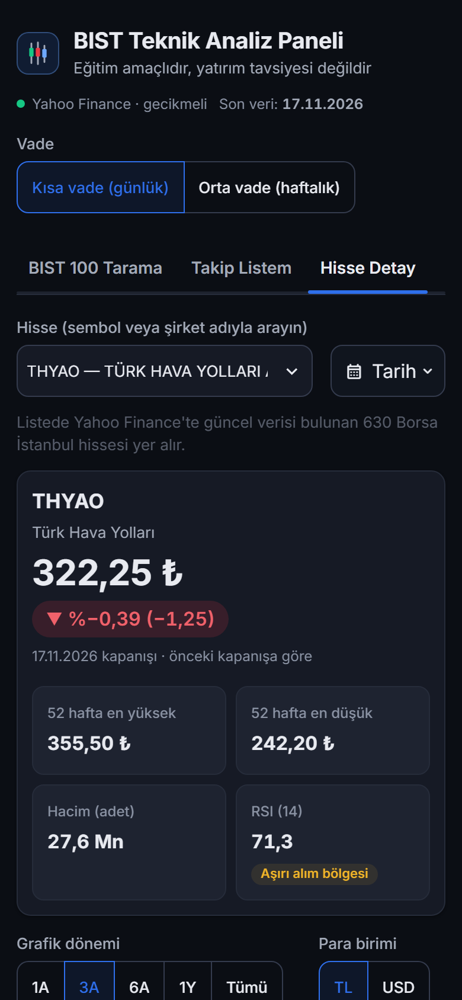
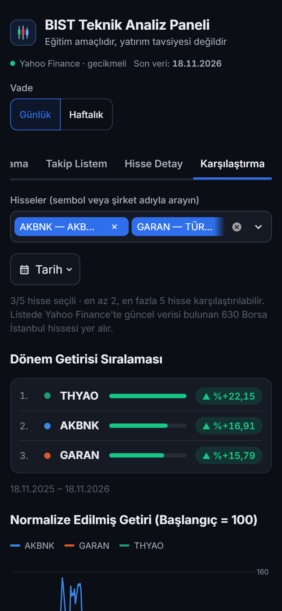
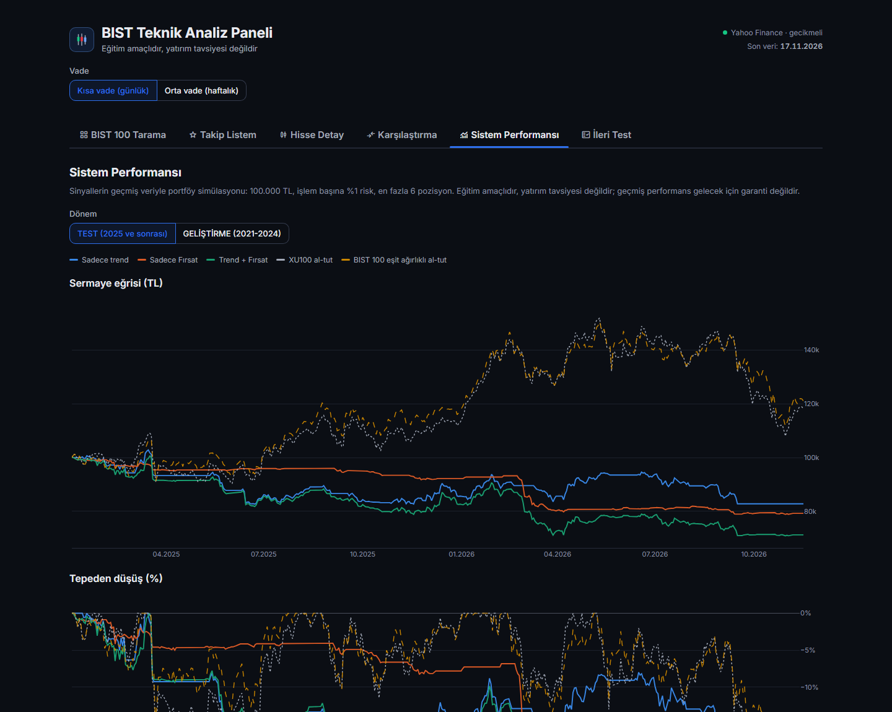

# BIST 100 Teknik Analiz Paneli

**[▶ Canlı demo](https://bist30-opsputfhf9b9i6kkjnyefc.streamlit.app/)** · [](https://github.com/mehmet-yuksell/Bist30/actions/workflows/ci.yml) · [](https://github.com/mehmet-yuksell/Bist30/actions/workflows/sinyal_gunlugu.yml)

Borsa İstanbul'daki BIST 100 hisseleri için Streamlit ile yazılmış Türkçe bir **araştırma ve risk takip
aracı**. Teknik göstergeleri, iki sinyal sisteminin (orijinal Bluetsman ve Bluetsman Alım/Sat v2) güncel
durumunu, satış uyarılarını ve kişisel takip listesini gösterir; her sinyalin geçmişte ve ileri testte ne
kadar işe yaradığını da yanında ölçer.

> **Bu bir al-sat sinyal servisi değildir.** Aşağıdaki test sonuçlarına göre alım sinyalleri 2025'ten bu
> yana maliyet sonrası pozitif getiri vermedi. Panelin değeri, sinyalleri ve riskleri ölçülmüş halleriyle,
> olumsuz sonuçlar dahil açıkça göstermesidir. Eğitim amaçlıdır, yatırım tavsiyesi değildir.

## Test sonuçları (TEST dönemi: 01.01.2025 – 17.11.2026)

Kurallar ve eşikler yalnızca 2021-2024 (GELİŞTİRME) verisiyle belirlendi; 2025 sonrası (TEST) hiçbir
ayarda kullanılmadı. Her sinyal ertesi gün açılıştan girilir; stop = kapanış − 1,5 ATR, hedef = 2R,
en fazla 20 iş günü, gidiş-dönüş %0,2 maliyet. "Rastgele gün", aynı hisselerde her günden aynı kurallarla
giriştir: bir sistem ancak bundan iyiyse bilgi taşır.

| Kısa vade alım sinyali | Sinyal | Hedef % | Stop % | Beklenen getiri (R) | Standart hata |
|---|---:|---:|---:|---:|---:|
| Orijinal Bluetsman (8 koşul) | 105 | 31,4 | 61,9 | **−0,089** | ±0,137 |
| Yeni sistem (Bluetsman Alım/Sat v2) | 350 | 30,9 | 63,4 | **−0,138** | ±0,072 |
| Rastgele gün (aynı kurallar) | 45.120 | 31,1 | 56,3 | **+0,018** | ±0,007 |

- **İki sistem de TEST'te rastgele girişten kötü;** aralarındaki fark (0,05 R) standart hatanın içinde,
  yani anlamlı değil. 2021-2024'te yeni sistem rastgeleden iyi görünüyordu (0,374 R'ye karşı 0,247 R);
  bu avantaj 2025 sonrasında kayboldu.
- **Satış uyarılarından KAR AL ve ÇIK** kısa vadede iki dönemde de rastgele bir günden daha iyi uyardı;
  SAT 2025 sonrasında uyarmadı.
- **FIRSAT** (sert düşüş sonrası toparlanma) TEST'te −0,147 R; hedefe ulaşma oranı yüksek (%69) ama
  hedef yakın, stop uzak. Düşen bıçak elemesi kötü sonuçlanan düşüşleri ayırt etmedi.
- **Portföy testi** (100.000 TL, işlem başına %1 risk): sadece trend sistemi TEST'te −%17,2; aynı dönemde
  XU100 al-tut +%18,1, eşit ağırlıklı BIST 100 al-tut +%21,1.

Ayrıntılar: [docs/sistem_raporu.md](docs/sistem_raporu.md) (tüm aşamalar, filtreler, kabul/red gerekçeleri)
ve [docs/bluetsman_karsilastirma.md](docs/bluetsman_karsilastirma.md) (iki sistemin karşılaştırması).


<p align="center">
  
  
  
</p>

## English summary

A Turkish-language **research and risk-tracking dashboard** for BIST 100 stocks, built with Streamlit
on delayed Yahoo Finance data. It shows technical indicators, two signal systems (the original
8-condition Bluetsman indicator and the Bluetsman Buy/Sell v2 engine), sell warnings, a dip-buying
setup, a personal watchlist and a daily signal log with forward testing. Every signal is evaluated with
the same no-look-ahead rules (enter at the next day's open, ATR stop, 2R target, 20-day time stop,
0.2% round-trip cost), with 2021-2024 used for development and 2025 onwards held out as a test set.
**On the test set neither buy-signal system beat random entries under the same rules**, and the
difference between them is not statistically significant; the dashboard reports this alongside the
signals. Educational project — not investment advice.

## Özellikler

### ⭐ Takip Listem
- Hisse ekleme: listeden seçerek ya da kod yazarak (BIST 100 dışı dahil; Yahoo'da verisi yoksa uyarı)
- İsteğe bağlı alış fiyatı, adet ve not; alış fiyatı girilen hisse "elimde var" sayılır (kâr/zarar % ve TL)
- Her hisse için iki vadede skor, not, satış baskısı, son sinyal, stop ve hedef
- **Karar özeti:** satışı değerlendir, kâr almayı düşün, alımı değerlendir, takipte kal, dikkat
- Liste tarayıcının localStorage'ında saklanır (`ui/takip_deposu.py`, Streamlit'in yerleşik bileşen API'si;
  ek paket yok); JSON indir/yükle ile yedeklenir. Fiyatlar BIST 100 taramasıyla aynı toplu indirmeden gelir

### 📈 Hisse Detay
- Borsa İstanbul'da Yahoo Finance'te güncel verisi bulunan **~630 hissenin tamamında** sembol veya şirket adıyla arama (sadece BIST 100 değil); listede yalnızca sonuç gösterebilen hisseler yer alır
- Üstte özet kartı: son fiyat, günlük değişim rozeti (▲/▼), 52 hafta en yüksek/en düşük, hacim, RSI
- Mum grafiği + hacim; SMA(50)/SMA(200)/EMA(20)/Bollinger Bantları "chip" düğmeleriyle aç-kapa
- Grafik dönemi seçimi (1A / 3A / 6A / 1Y / Tümü) — telefonda varsayılan son 3 ay
- Altta ayrı paneller halinde RSI (30/70 referans çizgileriyle) ve MACD
- **TL / USD görünüm anahtarı** — fiyatlar ve tüm göstergeler USDTRY kuruyla gerçek zamanlı dönüştürülür (kur etkisinden arındırılmış performans için)
- **Teknik Özet** kartı: RSI bölgesi, MACD kesişimi, fiyatın hareketli ortalamalara göre konumu, altın/ölüm kesişimi — rozetli satırlar halinde, tamamen tarafsız dille, "AL/SAT" ifadesi hiç kullanılmaz (alım sinyali yalnızca Bluetsman bölümünde, göstergenin kendi adıyla geçer)
- Her gösterge yanında "Bu ne anlama gelir?" açılır açıklama kutusu

### 🎯 Sinyal Karnesi (backtest)
Hisse Detay sekmesinin içinde, üç basit teknik sinyalin **geçmiş performansını** gösteren bölüm:
- RSI(14) aşırı satım/alım, MACD kesişimi, SMA 50/200 altın/ölüm kesişimi — ve "Al-Tut" karşılaştırması
- **İleriye bakış (look-ahead) hatası yok**: sinyal bir günün kapanışında oluşur, işlem ancak ertesi günün açılışında gerçekleşir
- Sabit, hisseye özel optimize edilmemiş parametreler; sadece uzun (long) pozisyon, kaldıraç yok
- Ayarlanabilir işlem maliyeti (varsayılan %0,1, her yönde)
- Bedelsiz sermaye artırımı/temettü düzeltmeli fiyatlarla hesaplanır
- Her strateji ve Al-Tut için kart: toplam getiri, maksimum düşüş, işlem sayısı, kazanç oranı; en yüksek / en düşük getiri vurgulanır
- Getiri eğrileri karşılaştırması; fiyat grafiğinde işaretlenmiş giriş/çıkış noktaları
- İşlem sayısı 10'un altındaysa "örnek sayısı yetersiz" uyarısı

### 🗓️ Vade seçimi
- Sayfanın üstünde **Kısa vade (günlük)** / **Orta vade (haftalık)**; tüm sekmelerde geçerli, oturum boyunca korunur
- Orta vadede grafik haftalık mumlarla çizilir; bu haftanın mumu cuma kapanışına kadar kesinleşmez (ön sinyal)

### 🔍 BIST 100 Tarama (açılış sekmesi)
- Bölümler: **Bugünün Alım Sinyalleri** (not ve tarihsel isabet), **Bugünün Satış Uyarıları** (SAT, KAR AL, ÇIK),
  **⚡ Fırsat Düşüşleri** (ve dönüş bekleyenler), **⚠️ Düşen Bıçak Riski**; her bölümün altında geçmiş testteki
  başarısı yazılır (olumsuzsa da)
- Tabloda kısa ve orta vade için ayrı skor ve sinyal sütunları
- **Bugünün Alım Sinyalleri:** son işlem gününde alım sinyali veren hisseler, alım skoruna göre
  kartlar halinde (kod, şirket, skor, fiyat, günlük değişim, stop, hedef, RSI, hacim katı).
  Bugün sinyal yoksa son 5 işlem günündeki sinyaller (kaç gün önce, sinyal fiyatı, sinyalden bu
  yana değişim) listelenir.
- Üstte son veri tarihi, son güncelleme saati ve piyasa durumu (Açık / Kapalı) ile "Şimdi yenile"
  düğmesi (en fazla 2 dakikada bir). Seans sürerken bugünkü sinyaller "Ön sinyal" olarak ayrı
  gösterilir; sinyaller kapanışla kesinleşir.
- Liste Borsa İstanbul'un resmî endeks bileşen dosyasından alınır (`config.py`, kaynak ve tarihle)
- Her hisse için 0-100 alım skoru, son sinyalin kaç gün önce oluştuğu, RSI ve hacim katı;
  "Son 10 günde sinyal verenler" filtresi ve hisse/şirket adıyla arama
- Görünüm cihaza göre seçilir: masaüstünde sıralanabilir tablo, telefonda kompakt liste

### 🔷 Bluetsman Alım Sistemi (`tarayici_motor.py`)
Bluetsman Alım/Sat v2 mantığının Python hesaplama motoru; panel kısa vade (günlük grafik)
ayarını kullanır:
- **Alım skoru (0-100):** kesişim tazeliği 15, fiyat > EMA 34 10, Supertrend 10, RSI 15,
  hacim 15, MACD 15, momentum 10, ADX 10
- **Sinyal:** EMA 13/34 kesişiminden sonra en çok 3 işlem günü içinde, fiyat EMA 34 üzerinde,
  haftalık kapanış 20 haftalık EMA üzerinde ve skor ≥ 60; her kesişime tek sinyal.
  Stop = kapanış − 1,5 ATR, hedef = kapanış + 3 ATR.
- Hisse Detay'da: grafikte EMA 13/34 ve geçmiş sinyaller için mavi üçgenler, skorun kalem kalem
  kırılımı (puan / maksimum), geçmiş sinyaller (stop, hedef, 10 işlem günü sonraki getiri)
- Hesap temettü düzeltmeli fiyatla yapılır (`motor_veri.py`: Yahoo'nun Adj Close / Close oranı)

### ⏱️ Güncel veri (`market.py`, `feed.py`)
- Önbellek piyasa saatine göre (Europe/Istanbul): seansta 15 dakikada bir, seans dışında bir
  sonraki açılışa kadar aynı veri. Yahoo verisi ~15 dakika gecikmeli olduğu için kapanış verisi
  18:40'a kadar yenilenir.
- Sayfa açık kalırsa Tarama ve Hisse Detay 15 dakikada bir kendini yeniler; sekme, arama ve
  filtre seçimleri korunur.
- Yahoo hata verir ya da veri boş/eksik gelirse son başarılı veri gösterilir ve "Veri
  güncellenemedi, X dakika önceki veri gösteriliyor" uyarısı çıkar.
- Resmî tatiller ayrıca tutulmaz: son verinin tarihi bugün değilse piyasa kapalı gösterilir.

### 📊 Sistem Performansı ve sinyal raporu


- `python tools/sistem_raporu.py` 10 yıllık veriyle sinyalleri değerlendirir ve
  [docs/sistem_raporu.md](docs/sistem_raporu.md) dosyasını üretir: ertesi gün açılıştan giriş,
  stop/hedef/zaman aşımı, %0,2 maliyet; GELİŞTİRME (2021-2024) ve TEST (2025-) ayrı; rastgele gün
  ve XU100 kıyası; alım filtreleri (F1-F8), FIRSAT sistemi ve portföy testi
- **Sistem Performansı** sekmesi portföy simülasyonunun sermaye eğrisini, tepeden düşüşünü ve
  metriklerini gösterir (100.000 TL, işlem başına %1 risk, en fazla 6 pozisyon; veri
  `data/sistem_performansi.*` dosyalarından okunur)
- Sonuçlar olumsuz olsa da olduğu gibi raporlanır; TEST dönemi kuralların ayarlanmasında kullanılmaz
- **Sinyal kalitesi notu (A/B/C):** alım sinyalleri skor aralığına göre 2021-2024 sonuçlarıyla notlanır,
  2025 sonrasında doğrulanır; doğrulanan not ve grubun tarihsel isabeti sinyal kartlarında gösterilir
  (`kalite.py`, `data/sinyal_kalitesi.json`)

### 🧪 Sinyal Günlüğü ve İleri Test
- GitHub Actions ([sinyal_gunlugu.yml](.github/workflows/sinyal_gunlugu.yml)) her iş günü 18:45'te
  (Türkiye) o günün tüm sinyallerini [data/sinyal_gunlugu.csv](data/sinyal_gunlugu.csv)'ye yazıp commit eder:
  vade, tür (alım, SAT, KAR AL, ÇIK, FIRSAT), hisse, skor, not, giriş referansı (sinyal günü kapanışı), stop,
  hedef. Orta vade sinyalleri yalnızca hafta tamamlandığında kaydedilir.
- **İleri Test** sekmesi günlükteki sinyallerin sonucunu Aşama 1 kurallarıyla gösterir (ertesi gün açılış
  girişi). Geçmiş testlerden farklı olarak kayıt anında gelecek bilinmez; 30'dan az sinyal sonuçlandıysa
  "Henüz yeterli veri yok" yazar. Günlük 17.11.2026'da başladı.

### ⚖️ Karşılaştırma
- Aynı ~630 hisselik liste arasından 2 ile 5 arasında seçip aynı grafikte karşılaştırın
- Dönem getirisi sıralaması kartı
- Başlangıcı 100 kabul eden normalize edilmiş getiri grafiği (farklı fiyat seviyelerindeki hisseleri adil karşılaştırmak için)
- Seçilen hisselerin günlük getirileri arasındaki korelasyon ısı haritası

## Kurulum

```powershell
git clone https://github.com/mehmet-yuksell/Bist30.git
cd Bist30
python -m venv venv
.\venv\Scripts\Activate.ps1
pip install -r requirements.txt
streamlit run app.py
```

Uygulama `http://localhost:8501` adresinde açılır.

## Testler

```powershell
pytest tests/ -v
```

Göstergeler, sinyal motoru, değerlendirme (elle kurulmuş fiyat serileriyle: ertesi gün açılış girişi,
aynı gün hedef+stop = stop vb.), filtreler (geleceğe bakmama testi dahil), FIRSAT, portföy, not sistemi,
takip listesi ve sinyal günlüğü birim testleriyle doğrulanır. Arayüz metinlerinde tavsiye dili ("AL/SAT")
yasaktır; yalnızca motorun satış sinyali adları (SAT, KAR AL, ÇIK) özel ad olarak muaftır.

Görsel (tarayıcı) testleri için geliştirme bağımlılıkları ayrıdır:

```powershell
pip install -r requirements-dev.txt
playwright install chromium
```

## Streamlit Community Cloud'a Dağıtım

1. Projeyi GitHub'a push edin (bkz. yukarıdaki kurulum adımları / commit geçmişi)
2. [share.streamlit.io](https://share.streamlit.io) adresine GitHub hesabınızla giriş yapın
3. "New app" düğmesine tıklayın
4. Repository, branch (`main`) ve ana dosya olarak `app.py` seçin
5. "Deploy" düğmesine tıklayın — birkaç dakika içinde uygulamanız yayında olur

## Proje Yapısı

```
app.py              Giriş noktası: sayfa ayarları, başlık, sekmeler, alt bilgi
tabs/
  hisse_detay.py    Hisse Detay sekmesi + alım sistemi kırılımı + Teknik Özet + Sinyal Karnesi
  tarama.py         BIST 100 Tarama: alım sinyalleri, satış uyarıları, fırsat, düşen bıçak, iki vadeli liste
  ileri_test.py     İleri Test sekmesi (Sinyal Günlüğü'nün sonuçları)
  karsilastirma.py  Karşılaştırma sekmesi
  performans.py     Sistem Performansı sekmesi (portföy simülasyonu sonuçları)
  takip.py          Takip Listem sekmesi
ui/
  theme.py          Tasarım token'ları (renk, boşluk, yarıçap) — CSS ve Plotly ortak kaynağı
  styles.py         CSS tasarım sistemi + mobil öncelikli medya sorguları
  components.py     HTML bileşenleri (hero, kartlar, rozetler, sinyal kartı, liste, durumlar)
  charts.py         Plotly grafik oluşturucuları (ortak mobil/masaüstü düzeni)
  controls.py       Ortak form kontrolleri (hisse arama, tarih aralığı)
  format.py         Türkçe sayı/tarih biçimlendirme (1.234,56 · %+1,23 · gg.aa.yyyy)
  viewport.py       Ekran genişliği sınıfını (telefon/tablet/masaüstü) Python'a bildirir
config.py           BIST 100 hisse listesi (Borsa İstanbul kaynağı ve tarihiyle)
data.py             Yahoo Finance'den veri çekme, önbellekleme, hata yönetimi
indicators.py       SMA, EMA, RSI (Wilder), MACD, Bollinger Bantları — sıfırdan
signals.py          Gösterge değerlerinden tarafsız Türkçe gözlem metinleri
tarayici_motor.py   Bluetsman Alım/Sat v2 hesaplama motoru (skor, sinyal, stop/hedef, isabet testi)
motor_veri.py       data.py çıktısı -> motor girdisi (temettü düzeltmesi) ve sinyal özetleri
market.py           BIST seans saati ve önbellek zaman dilimi (Europe/Istanbul)
feed.py             Piyasa saatine göre güncel veri, son başarılı veriye dönüş, yenileme sınırı
bluetsman.py        Orijinal 8 koşullu Bluetsman (Pine) aktarımı; panelde kullanılmıyor, karşılaştırma için duruyor
evaluation.py       Sinyal değerlendirme (işlem simülasyonu, metrikler, dönem ayrımı)
filtreler.py        Alım sinyali kalite filtreleri F1-F8
firsat.py           FIRSAT sistemi (sert düşüş sonrası toparlanma) ve düşen bıçak elemesi
portfoy.py          Portföy simülasyonu (pozisyon büyüklüğü, risk, rejim) ve metrikler
kalite.py           Sinyal kalitesi notu (geçmiş performansa göre A/B/C, TEST doğrulaması)
panel_veri.py       Panel listeleri: iki vadenin sinyalleri, satış uyarıları, fırsat ve bıçak durumu
takip.py            Takip listesi modeli, satırlar ve karar özeti kuralları
gunluk.py           Sinyal Günlüğü kaydı ve ileri test değerlendirmesi
backtest.py         Sinyal Karnesi: look-ahead içermeyen basit backtest motoru
ui_text.py          Tüm arayüz metinleri (tek merkezden yönetim)
data/bist_all.csv   KAP kaynaklı şirket listesi + Yahoo'da güncel verisi olup olmadığı (yahoo_data)
tools/
  update_yahoo_coverage.py  bist_all.csv'deki yahoo_data işaretlerini yeniden hesaplar
  check_bist100.py          config'teki BIST 100 listesini Borsa İstanbul'un güncel dosyasıyla karşılaştırır
  sistem_raporu.py          sinyal ve portföy değerlendirmesi -> docs/sistem_raporu.md, data/sistem_performansi.*
  bluetsman_karsilastirma.py  orijinal Bluetsman ile yeni sistemin karşılaştırması -> docs/bluetsman_karsilastirma.md
  sinyal_gunlugu.py         günün sinyallerini data/sinyal_gunlugu.csv'ye ekler (GitHub Actions çalıştırır)
tests/              pytest testleri
docs/               Raporlar ve ekran görüntüleri
.github/workflows/  ci.yml (testler), sinyal_gunlugu.yml (her iş günü 18:45 sinyal kaydı)
```

## Mobil uyumluluk

Arayüz önce 390 px genişlik (iPhone 14) için tasarlandı, sonra tablet ve
masaüstüne genişletildi:

- **Kırılım noktaları:** < 768 px telefon, 768–1023 px tablet, ≥ 1024 px masaüstü.
  Düzenin asıl kaynağı CSS medya sorgularıdır; grafik yüksekliği, varsayılan
  grafik dönemi ve liste/tablo seçimi gibi Python'da verilmesi gereken kararlar
  için `ui/viewport.py` ekran genişliğini Streamlit'in yerleşik bileşen API'siyle
  (ek paket olmadan) ölçer.
- **Yatay kaydırma yok:** 390, 768 ve 1440 px genişliklerde her sekme Playwright
  ile ölçüldü (`scrollWidth ≤ innerWidth`); `overflow-x: hidden` ile gizlenmedi.
- **Dokunma hedefleri** telefon ve tablette en az 44 px (sekmeler, düğmeler,
  seçim kutuları, chip'ler).
- **Grafikler** telefonda sabit eksenli: grafiğin üzerinde parmakla kaydırmak
  sayfayı kaydırır, yakınlaştırmaz (dokunma olaylarıyla test edildi). Lejant
  grafiğin üstünde HTML olarak durur ve satır kırar; araç çubuğu telefonda gizli.
- **Telefonda** metrikler 2×2 ızgara, sütunlar alt alta, tarama sonuçları kompakt
  liste, tarih aralığı varsayılan olarak kapalı bir "Tarih" panelinde.

## Tasarım sistemi

- **Renkler** `ui/theme.py`'de tek yerde: koyu zemin `#0B0E14`, kart `#161A25`,
  yükseliş `#16C784`, düşüş `#EA3943` (metinde kontrast için `#F0616A`), tek vurgu
  rengi mavi. Yön her zaman renge ek olarak ▲/▼ ve +/− ile gösterilir.
- **Kontrast:** tüm metin renkleri kart yüzeyinde en az 4.5:1 (WCAG AA);
  klavye odağı görünür halkayla belirtilir.
- **Ölçekler:** boşluk 4/8/12/16/24/32 px, köşe yarıçapı 8/12 px, başlıklar
  `clamp()` ile ölçeklenir; rakamlar `tabular-nums` ile hizalı.
- **Tipografi:** Inter (Google Fonts), yoksa sistem sans-serif.
- **Seri renkleri** renk körlüğü simülasyonuyla doğrulanmış sabit bir sıradan
  gelir; korelasyon ısı haritası bilinçli olarak yön renkleri (yeşil/kırmızı)
  yerine nötr mavi–kırmızı ıraksak skala kullanır.

## Teknoloji

Python 3.12+, Streamlit, yfinance, pandas, numpy, plotly, pytest. Teknik
göstergeler hazır bir kütüphane (ör. pandas-ta) kullanılmadan, pandas/numpy
ile sıfırdan yazılmıştır.

## Sınırlamalar

- **Hayatta kalma yanlılığı:** testler bugünkü BIST 100 listesiyle yapıldı. Geçmişte endeksten çıkan,
  iflas eden ya da işlemden kaldırılan hisseler yok; sonuçlar olduğundan iyimser olabilir.
- **TEST dönemi kısa (~23 ay) ve sinyal sayıları sınırlı.** Raporlardaki standart hatalar küçük farkların
  gürültüden ayırt edilemediğini gösterir; birden fazla filtre/kural denendiği için bazı "iyi" sonuçlar şans
  eseri olabilir.
- **Modellenmeyenler:** vergi, kayma (slippage), tavan/taban kilidinde işlem yapılamaması, açığa satış
  kısıtları. Gün içi fiyat sırası bilinmediği için aynı gün hem stop hem hedef görülürse stop sayılır.
- **İleri test henüz yeni:** Sinyal Günlüğü 17.11.2026'da başladı; anlamlı bir sonuç için aylar gerekir.
  GitHub zamanlanmış işleri bazen gecikir; resmî tatilde ya da Yahoo verisi gelmediğinde kayıt yapılmaz.
- **BIST 100 listesi elle güncellenir.** Endeks bileşenleri üç ayda bir
  değişebilir; liste `config.py` içinde belirtilen tarihte doğrulanmıştır.
  `python tools/check_bist100.py` farkları gösterir.
- **Bugünkü mum kapanmadan kesin değildir.** Seans içinde son gün henüz
  tamamlanmadığı için hacim düşük görünebilir; bugünkü skor ve sinyal kapanışa
  kadar değişebilir (TradingView'de de aynıdır).
- **Yahoo'nun bölünme/bedelsiz kayıtları bazen hatalıdır.** Temettü düzeltmesi
  bunları düzeltmez; bazı hisselerde (ör. FENER, TUKAS, EUREN, CVKMD) geçmişte
  gerçekte olmayan tek günlük sert düşüşler görünür ve o dönemin göstergelerini bozar.
- **Veriler gecikmelidir.** Yahoo Finance üzerinden alınan fiyatlar gerçek
  zamanlı değildir.
- **Eğitim amaçlıdır, yatırım tavsiyesi değildir.** Göstergeler yalnızca
  geçmiş fiyat hareketlerine dayanır ve geleceği garanti etmez.
- **Tek veri kaynağına bağımlıdır.** Yahoo Finance'in erişilemediği
  durumlarda veri gelmeyebilir (uygulama bu durumda çökmez, anlaşılır bir
  hata mesajı gösterir). Yahoo bazen son günü kapanış fiyatı olmadan
  döndürür; bu satırlar atılır ve en son gerçek kapanış gösterilir.
- **Arama listesi elle güncellenir.** KAP'taki ~790 şirketten Yahoo'da
  güncel verisi olan ~630'u listelenir. Yeni halka arzlar ya da işlemden
  kaldırılan hisseler için `python tools/update_yahoo_coverage.py`
  yeniden çalıştırılmalıdır.
- **Tarama yalnızca BIST 100'ü kapsar.** Hisse Detay ve Karşılaştırma'daki
  geniş arama (~630 hisse) bilinçli olarak bu sekmeye uygulanmadı; yüzlerce
  hisseyi tek seferde çekmek Yahoo Finance'in hız sınırlarına takılabilir.
- **Sinyal Karnesi gerçek bir yatırım stratejisi değildir, basitleştirilmiş
  bir eğitim modelidir.** Vergi, kayma (slippage) ve likidite dikkate
  alınmaz; parametreler sabittir ve hisseye özel optimize edilmemiştir;
  geçmiş performans gelecek için garanti değildir. Az sayıda sinyal
  üreten dönemlerde (özellikle altın/ölüm kesişimi gibi nadir sinyallerde)
  sonuçlar istatistiksel olarak güvenilir olmayabilir — bu durumda
  uygulama açıkça uyarır.
- **TL/USD dönüşümü yalnızca Hisse Detay grafiğine uygulanır**, Sinyal
  Karnesi her zaman TL bazlı hesaplanır.
- **Bazı Streamlit bileşenleri tam Türkçe biçimlenemez.** Örneğin işlem
  maliyeti sayı kutusu ondalık ayırıcı olarak nokta gösterir (0.10); bu,
  Streamlit'in yerleşik bileşeninin sınırıdır.

---

*Yatırım tavsiyesi değildir. Veriler Yahoo Finance üzerinden alınır ve
gecikmeli olabilir. Eğitim amaçlı bir projedir.*
