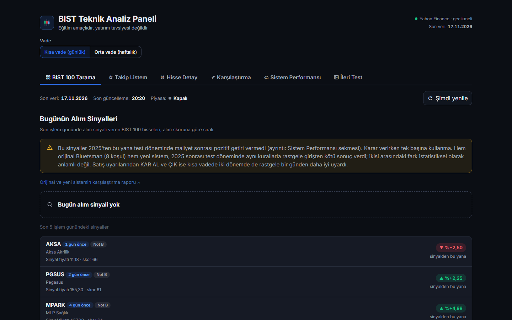
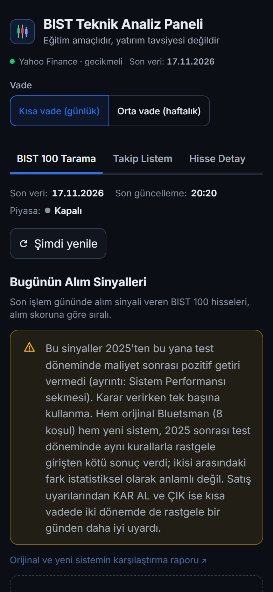

# BIST 100 Teknik Analiz Paneli

**[▶ Canlı demo](https://bist30-opsputfhf9b9i6kkjnyefc.streamlit.app/)** · [](https://github.com/mehmet-yuksell/Bist30/actions/workflows/ci.yml)

A Turkish Streamlit dashboard for BIST 100 stocks. Buy and sell signals come only from two
TradingView Pine Script indicators, **Bluetsman Alım 1.2** and **Bluetsman Satım 1.2**, ported line by line
to Python, on daily and weekly bars.

Borsa İstanbul'daki BIST 100 hisseleri için Streamlit ile yazılmış Türkçe bir teknik analiz paneli.
Alım ve satış sinyalleri yalnızca iki TradingView Pine göstergesinden gelir: **Bluetsman Alım 1.2** ve
**Bluetsman Satım 1.2**. İkisi de Python'a satır satır aktarıldı ve günlük ve haftalık mumlarla hesaplanır.
Panelde ayrıca takip listesi, hisse detayı, teknik özet ve karşılaştırma bulunur.

> Yatırım tavsiyesi değildir. Eğitim amaçlı bir projedir; veriler Yahoo Finance'ten gecikmeli gelir.



<p align="center">
  
  
  
</p>

## Özellikler

### ⭐ Takip Listem
- Hisse ekleme: listeden seçerek ya da kod yazarak (BIST 100 dışı dahil; Yahoo'da verisi yoksa uyarı)
- İsteğe bağlı alış fiyatı, adet ve not; alış fiyatı girilen hisse "elimde var" sayılır (kâr/zarar % ve TL)
- Her hisse için iki vadede (günlük, haftalık) Alım 1.2 skoru ve son alım/satış sinyali
- **Karar özeti** (son 5 mum): elindeki hissede SAT → satışı değerlendir, KAR AL → kâr almayı düşün;
  elinde olmayan hissede ardından satış sinyali gelmemiş alım sinyali → alımı değerlendir; EMA 13 ile
  EMA 34 kesişmeye yakın ve alım skoru yükseliyorsa → takipte kal
- Liste tarayıcının localStorage'ında saklanır (`ui/takip_deposu.py`, Streamlit'in yerleşik bileşen API'si;
  ek paket yok); JSON indir/yükle ile yedeklenir. Fiyatlar BIST 100 taramasıyla aynı toplu indirmeden gelir

### 📈 Hisse Detay
- Borsa İstanbul'da Yahoo Finance'te güncel verisi bulunan **~630 hissenin tamamında** sembol veya şirket adıyla arama (sadece BIST 100 değil); listede yalnızca sonuç gösterebilen hisseler yer alır
- Üstte özet kartı: son fiyat, günlük değişim rozeti (▲/▼), 52 hafta en yüksek/en düşük, hacim, RSI
- Mum grafiği + hacim; Bluetsman (EMA 13/34 ve sinyal işaretleri), EMA 5, SMA(50)/SMA(200)/EMA(20)/Bollinger
  Bantları "chip" düğmeleriyle aç-kapa
- Grafik dönemi seçimi (1A / 3A / 6A / 1Y / Tümü) — telefonda varsayılan son 3 ay
- Altta ayrı paneller halinde RSI (30/70 referans çizgileriyle) ve MACD
- **TL / USD görünüm anahtarı** — fiyatlar ve tüm göstergeler USDTRY kuruyla gerçek zamanlı dönüştürülür (kur etkisinden arındırılmış performans için)
- **Teknik Özet** kartı: RSI bölgesi, MACD kesişimi, fiyatın hareketli ortalamalara göre konumu, altın/ölüm kesişimi — rozetli satırlar halinde, tarafsız dille (alım ve satış sinyalleri yalnızca Bluetsman bölümünde, göstergelerin kendi adlarıyla geçer)
- Her gösterge yanında "Bu ne anlama gelir?" açılır açıklama kutusu

### 🎯 Sinyal Karnesi (backtest)
Hisse Detay sekmesinin içinde, üç basit teknik sinyalin **geçmiş performansını** gösteren bölüm:
- RSI(14) aşırı satım/alım, MACD kesişimi, SMA 50/200 altın/ölüm kesişimi — ve "Al-Tut" karşılaştırması
- **İleriye bakış (look-ahead) hatası yok**: sinyal bir günün kapanışında oluşur, işlem ancak ertesi günün açılışında gerçekleşir
- Sabit, hisseye özel optimize edilmemiş parametreler; sadece uzun (long) pozisyon, kaldıraç yok
- Ayarlanabilir işlem maliyeti (varsayılan %0,1, her yönde)
- Bedelsiz sermaye artırımı/temettü düzeltmeli fiyatlarla hesaplanır
- Her strateji ve Al-Tut için kart: toplam getiri, maksimum düşüş, işlem sayısı, kazanç oranı; en yüksek / en düşük getiri vurgulanır
- Getiri eğrileri karşılaştırması; fiyat grafiğinde işaretlenmiş giriş/çıkış noktaları
- İşlem sayısı 10'un altındaysa "örnek sayısı yetersiz" uyarısı

### 🗓️ Vade seçimi
- Sayfanın üstünde **Günlük** / **Haftalık**; tüm sekmelerde geçerli, oturum boyunca korunur
- Haftalık vadede iki gösterge de cuma kapanışlı haftalık mumlarla hesaplanır ve grafik haftalık çizilir;
  bu haftanın mumu cuma kapanışına kadar kesinleşmez (ön sinyal)

### 🔍 BIST 100 Tarama (açılış sekmesi)
- **Bugünün Alım Sinyalleri:** son mumda Alım 1.2 sinyali veren hisseler, skora göre kartlar halinde
  (skor, fiyat, günlük değişim, RSI, hacim katı, ADX)
- **Bugünün Satış Sinyalleri:** son mumda Satım 1.2'nin SAT (kırmızı) ya da KAR AL (mavi) sinyali veren
  hisseler ve altında son 5 mumun satış sinyalleri
- **Kısa Vade Fırsatları:** son 5 mumda alım sinyali gelen ve o günden bu yana satış sinyali gelmeyen
  hisseler, sinyal fiyatı ve sinyalden bu yana değişimle
- Tabloda iki vade için ayrı skor, son alım ve son satış sütunları; "Son 10 günde sinyal verenler"
  filtresi ve hisse/şirket adıyla arama
- Üstte son veri tarihi, son güncelleme saati ve piyasa durumu (Açık / Kapalı) ile "Şimdi yenile"
  düğmesi (en fazla 2 dakikada bir). Seans sürerken bugünkü sinyaller "Ön sinyal" rozetiyle gösterilir;
  sinyaller kapanışla kesinleşir.
- Liste Borsa İstanbul'un resmî endeks bileşen dosyasından alınır (`config.py`, kaynak ve tarihle)
- Görünüm cihaza göre seçilir: masaüstünde sıralanabilir tablo, telefonda kompakt liste

### 🔷 Bluetsman Alım 1.2 ve Satım 1.2 (`bluetsman.py`)
İki TradingView Pine Script v5 göstergesinin birebir Python karşılığı. `ta.rma`, `ta.atr`, `ta.tr`,
`ta.crossover/crossunder` ve göstergelerin standart dışı Supertrend'i Pine'daki gibi hesaplanır; `na`
karşılaştırmaları Pine'daki gibi yanlış döner.
- **Alım 1.2:** sinyal için sekiz koşulun hepsi aynı mumda sağlanmalı: EMA 13'ün EMA 34'ü yukarı
  kesmesi, hacim > 20 mumluk ortalama × 1,05, RSI(14) > 50, momentum > 0, MACD histogramı > 0, fiyat >
  EMA 34, Supertrend (ATR 10, çarpan 3) yukarı, ADX(14) > 20. Skor (0-100) her mumda koşul puanlarından
  toplanır (70+ yeşil, 40-69 turuncu, altı kırmızı; Pine'daki renkler).
- **Satım 1.2:** Supertrend (ATR 10, çarpan 2,5) yukarıyken EMA 5'in EMA 13'ü aşağı kestiği mumda satış
  sinyali oluşur. Skor: RSI > 50 (10), hacim (10), 2 mumluk momentum > 0 (15), MACD histogramı > 0 (6),
  ADX(7) > 20 (15), kesişim (10), Supertrend (10); en fazla 76. **SAT:** skor 61 ve üstü, **KAR AL:**
  40-60.
- Hisse Detay'da grafik işaretleri Pine'daki gibidir: alım mumun altında mavi ▲, KAR AL mumun üstünde
  mavi ▲, SAT mumun üstünde kırmızı ▼. Altında Alım 1.2'nin sekiz koşulu (✓/✗ ve puan), Satım 1.2'nin
  bugünkü koşulları ve seçili aralıktaki geçmiş sinyaller (10 mum sonraki değişimle) yer alır.
- Fiyat girdisi (`panel_veri.py`): TradingView'in varsayılan grafiği gibi yalnızca bölünmeye göre
  düzeltilmiş fiyat (temettü düzeltmesi yok). Yahoo'nun kaçırdığı bölünme/bedelsizler, ±%10 fiyat
  limitinin ötesindeki açılış boşluklarından onarılır.
- Kaynaktaki parametreler ve kurallar değiştirilmedi; ek filtre, stop/hedef ya da puanlama eklenmedi.

### ⏱️ Güncel veri (`market.py`, `feed.py`)
- Önbellek piyasa saatine göre (Europe/Istanbul): seansta 15 dakikada bir, seans dışında bir
  sonraki açılışa kadar aynı veri. Yahoo verisi ~15 dakika gecikmeli olduğu için kapanış verisi
  18:40'a kadar yenilenir.
- Sayfa açık kalırsa Tarama ve Hisse Detay 15 dakikada bir kendini yeniler; sekme, arama ve
  filtre seçimleri korunur.
- Yahoo hata verir ya da veri boş/eksik gelirse son başarılı veri gösterilir ve "Veri
  güncellenemedi, X dakika önceki veri gösteriliyor" uyarısı çıkar.
- Resmî tatiller ayrıca tutulmaz: son verinin tarihi bugün değilse piyasa kapalı gösterilir.

### ⚖️ Karşılaştırma
- Aynı ~630 hisselik liste arasından 2 ile 5 arasında seçip aynı grafikte karşılaştırın
- Dönem getirisi sıralaması kartı
- Başlangıcı 100 kabul eden normalize edilmiş getiri grafiği (farklı fiyat seviyelerindeki hisseleri adil karşılaştırmak için)
- Seçilen hisselerin günlük getirileri arasındaki korelasyon ısı haritası

## Kurulum

```powershell
git clone https://github.com/mehmet-yuksell/Bist30.git
cd Bist30
python -m venv venv
.\venv\Scripts\Activate.ps1
pip install -r requirements.txt
streamlit run app.py
```

Uygulama `http://localhost:8501` adresinde açılır.

## Testler

```powershell
pytest tests/ -v
```

Göstergeler, iki Pine aktarımı (Pine tanımlarından elle hesaplanmış değerler, kesişim kuralları,
skor aralıkları), fiyat girdisi ve bölünme onarımı, haftalık mumlar, sinyal listeleri ve takip listesi
birim testleriyle doğrulanır. Arayüz metinlerinde tavsiye dili ("AL/SAT") yasaktır; yalnızca Satım 1.2'nin
sinyal adları (SAT, KAR AL) özel ad olarak muaftır.

Görsel (tarayıcı) testleri için geliştirme bağımlılıkları ayrıdır:

```powershell
pip install -r requirements-dev.txt
playwright install chromium
```

## Streamlit Community Cloud'a Dağıtım

1. Projeyi GitHub'a push edin (bkz. yukarıdaki kurulum adımları / commit geçmişi)
2. [share.streamlit.io](https://share.streamlit.io) adresine GitHub hesabınızla giriş yapın
3. "New app" düğmesine tıklayın
4. Repository, branch (`main`) ve ana dosya olarak `app.py` seçin
5. "Deploy" düğmesine tıklayın — birkaç dakika içinde uygulamanız yayında olur

## Proje Yapısı

```
app.py              Giriş noktası: sayfa ayarları, başlık, vade seçimi, sekmeler, alt bilgi
tabs/
  tarama.py         BIST 100 Tarama: alım ve satış sinyalleri, kısa vade fırsatları, iki vadeli liste
  takip.py          Takip Listem sekmesi
  hisse_detay.py    Hisse Detay: grafik, Alım 1.2 / Satım 1.2 durumu, Teknik Özet, Sinyal Karnesi
  karsilastirma.py  Karşılaştırma sekmesi
ui/
  theme.py          Tasarım token'ları (renk, boşluk, yarıçap) — CSS ve Plotly ortak kaynağı
  styles.py         CSS tasarım sistemi + mobil öncelikli medya sorguları
  components.py     HTML bileşenleri (hero, kartlar, rozetler, sinyal kartı, liste, durumlar, alt bilgi)
  charts.py         Plotly grafik oluşturucuları (ortak mobil/masaüstü düzeni)
  controls.py       Ortak form kontrolleri (hisse arama, tarih aralığı)
  format.py         Türkçe sayı/tarih biçimlendirme (1.234,56 · %+1,23 · gg.aa.yyyy)
  takip_deposu.py   Takip listesinin tarayıcıda (localStorage) saklanması
  viewport.py       Ekran genişliği sınıfını (telefon/tablet/masaüstü) Python'a bildirir
config.py           BIST 100 hisse listesi (Borsa İstanbul kaynağı ve tarihiyle)
data.py             Yahoo Finance'den veri çekme, önbellekleme, hata yönetimi
market.py           BIST seans saati ve önbellek zaman dilimi (Europe/Istanbul)
feed.py             Piyasa saatine göre güncel veri, son başarılı veriye dönüş, yenileme sınırı
indicators.py       SMA, EMA, RSI (Wilder), MACD, Bollinger Bantları — sıfırdan
bluetsman.py        Bluetsman Alım 1.2 ve Satım 1.2 (Pine) aktarımı
panel_veri.py       Fiyat girdisi (bölünme onarımı), haftalık mumlar, iki vadenin sinyal listeleri
takip.py            Takip listesi modeli, satırlar ve karar özeti kuralları
signals.py          Gösterge değerlerinden tarafsız Türkçe gözlem metinleri
backtest.py         Sinyal Karnesi: look-ahead içermeyen basit backtest motoru
ui_text.py          Tüm arayüz metinleri (tek merkezden yönetim)
data/bist_all.csv   KAP kaynaklı şirket listesi + Yahoo'da güncel verisi olup olmadığı (yahoo_data)
tools/
  update_yahoo_coverage.py  bist_all.csv'deki yahoo_data işaretlerini yeniden hesaplar
  check_bist100.py          config'teki BIST 100 listesini Borsa İstanbul'un güncel dosyasıyla karşılaştırır
tests/              pytest testleri
docs/               Ekran görüntüleri
.github/workflows/  ci.yml (testler)
```

## Mobil uyumluluk

Arayüz önce 390 px genişlik (iPhone 14) için tasarlandı, sonra tablet ve
masaüstüne genişletildi:

- **Kırılım noktaları:** < 768 px telefon, 768–1023 px tablet, ≥ 1024 px masaüstü.
  Düzenin asıl kaynağı CSS medya sorgularıdır; grafik yüksekliği, varsayılan
  grafik dönemi ve liste/tablo seçimi gibi Python'da verilmesi gereken kararlar
  için `ui/viewport.py` ekran genişliğini Streamlit'in yerleşik bileşen API'siyle
  (ek paket olmadan) ölçer.
- **Yatay kaydırma yok:** 390, 768 ve 1440 px genişliklerde her sekme Playwright
  ile ölçüldü (`scrollWidth ≤ innerWidth`); `overflow-x: hidden` ile gizlenmedi.
- **Dokunma hedefleri** telefon ve tablette en az 44 px (sekmeler, düğmeler,
  seçim kutuları, chip'ler).
- **Grafikler** telefonda sabit eksenli: grafiğin üzerinde parmakla kaydırmak
  sayfayı kaydırır, yakınlaştırmaz (dokunma olaylarıyla test edildi). Lejant
  grafiğin üstünde HTML olarak durur ve satır kırar; araç çubuğu telefonda gizli.
- **Telefonda** metrikler 2×2 ızgara, sütunlar alt alta, tarama sonuçları kompakt
  liste, tarih aralığı varsayılan olarak kapalı bir "Tarih" panelinde.

## Tasarım sistemi

- **Renkler** `ui/theme.py`'de tek yerde: koyu zemin `#0B0E14`, kart `#161A25`,
  yükseliş `#16C784`, düşüş `#EA3943` (metinde kontrast için `#F0616A`), tek vurgu
  rengi mavi. Yön her zaman renge ek olarak ▲/▼ ve +/− ile gösterilir.
- **Kontrast:** tüm metin renkleri kart yüzeyinde en az 4.5:1 (WCAG AA);
  klavye odağı görünür halkayla belirtilir.
- **Ölçekler:** boşluk 4/8/12/16/24/32 px, köşe yarıçapı 8/12 px, başlıklar
  `clamp()` ile ölçeklenir; rakamlar `tabular-nums` ile hizalı.
- **Tipografi:** Inter (Google Fonts), yoksa sistem sans-serif.
- **Seri renkleri** renk körlüğü simülasyonuyla doğrulanmış sabit bir sıradan
  gelir; korelasyon ısı haritası bilinçli olarak yön renkleri (yeşil/kırmızı)
  yerine nötr mavi–kırmızı ıraksak skala kullanır.

## Teknoloji

Python 3.12+, Streamlit, yfinance, pandas, numpy, plotly, pytest. Teknik
göstergeler hazır bir kütüphane (ör. pandas-ta) kullanılmadan, pandas/numpy
ile sıfırdan yazılmıştır.

## Sınırlamalar

- **TradingView ile küçük farklar olabilir.** Hesaplar Pine ile aynıdır, ancak EMA ve Supertrend gibi
  önceki değere bağlı göstergeler veri başlangıcına duyarlıdır: tarama son ~2 yılın verisiyle,
  TradingView ise hissenin tüm geçmişiyle başlar. Yahoo ile TradingView'in hacim ve fiyat verisi de
  birebir aynı olmayabilir.
- **Sinyaller nadirdir.** Alım 1.2 sekiz koşulun aynı mumda sağlanmasını ister; birçok günde BIST 100'de
  hiç sinyal oluşmaz. Satım 1.2'de skoru 40'ın altında kalan satış kesişimleri göstergede işaretlenmez.
- **BIST 100 listesi elle güncellenir.** Endeks bileşenleri üç ayda bir
  değişebilir; liste `config.py` içinde belirtilen tarihte doğrulanmıştır.
  `python tools/check_bist100.py` farkları gösterir.
- **Bugünkü mum kapanmadan kesin değildir.** Seans içinde son gün henüz
  tamamlanmadığı için hacim düşük görünebilir; bugünkü skor ve sinyal kapanışa
  kadar değişebilir (TradingView'de de aynıdır).
- **Yahoo'nun bölünme/bedelsiz kayıtları bazen hatalıdır.** Bluetsman hesabında fiyat limitinin
  ötesindeki açılış boşlukları onarılır; grafik ve Sinyal Karnesi ise Yahoo'nun verisini olduğu gibi
  kullanır, bu yüzden bazı hisselerde (ör. FENER, TUKAS, EUREN, CVKMD) geçmişte gerçekte olmayan
  tek günlük sert düşüşler görünebilir.
- **Veriler gecikmelidir.** Yahoo Finance üzerinden alınan fiyatlar gerçek
  zamanlı değildir.
- **Eğitim amaçlıdır, yatırım tavsiyesi değildir.** Göstergeler yalnızca
  geçmiş fiyat hareketlerine dayanır ve geleceği garanti etmez.
- **Tek veri kaynağına bağımlıdır.** Yahoo Finance'in erişilemediği
  durumlarda veri gelmeyebilir (uygulama bu durumda çökmez, anlaşılır bir
  hata mesajı gösterir). Yahoo bazen son günü kapanış fiyatı olmadan
  döndürür; bu satırlar atılır ve en son gerçek kapanış gösterilir.
- **Arama listesi elle güncellenir.** KAP'taki ~790 şirketten Yahoo'da
  güncel verisi olan ~630'u listelenir. Yeni halka arzlar ya da işlemden
  kaldırılan hisseler için `python tools/update_yahoo_coverage.py`
  yeniden çalıştırılmalıdır.
- **Tarama yalnızca BIST 100'ü kapsar.** Hisse Detay ve Karşılaştırma'daki
  geniş arama (~630 hisse) bilinçli olarak bu sekmeye uygulanmadı; yüzlerce
  hisseyi tek seferde çekmek Yahoo Finance'in hız sınırlarına takılabilir.
- **Sinyal Karnesi gerçek bir yatırım stratejisi değildir, basitleştirilmiş
  bir eğitim modelidir.** Vergi, kayma (slippage) ve likidite dikkate
  alınmaz; parametreler sabittir ve hisseye özel optimize edilmemiştir;
  geçmiş performans gelecek için garanti değildir. Az sayıda sinyal
  üreten dönemlerde (özellikle altın/ölüm kesişimi gibi nadir sinyallerde)
  sonuçlar istatistiksel olarak güvenilir olmayabilir — bu durumda
  uygulama açıkça uyarır.
- **TL/USD dönüşümü yalnızca Hisse Detay grafiğine uygulanır**, Sinyal
  Karnesi her zaman TL bazlı hesaplanır.
- **Bazı Streamlit bileşenleri tam Türkçe biçimlenemez.** Örneğin işlem
  maliyeti sayı kutusu ondalık ayırıcı olarak nokta gösterir (0.10); bu,
  Streamlit'in yerleşik bileşeninin sınırıdır.

## Kişisel veriler (KVKK)

Uygulama üyelik istemez ve kişisel veri toplamaz. Takip listesi yalnızca kullanıcının tarayıcısında
(localStorage) saklanır; hesaplama için oturum boyunca sunucuya iletilir, kalıcı olarak kaydedilmez.
Streamlit kullanım istatistikleri kapalıdır (`.streamlit/config.toml`). Barındırma hizmeti (Streamlit
Community Cloud) standart teknik erişim kayıtları tutabilir.

---

*Yatırım tavsiyesi değildir. Veriler Yahoo Finance üzerinden alınır ve
gecikmeli olabilir. Eğitim amaçlı bir projedir.*

<sub>Mehmet Yüksel · 2026</sub>
